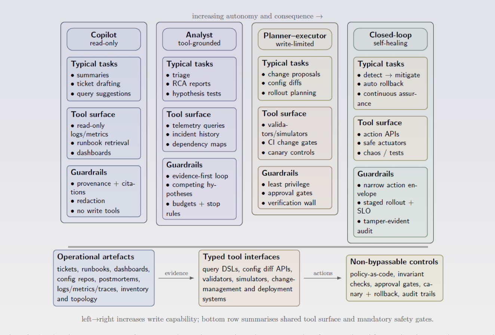

<h1 align="center">
  
</h1>

  <b>Satellite Operations Copilot with Non-Bypassable Assurance Gates</b>  
  <i>an intelligent incident investigation system for satellite operations, combining real spacecraft telemetry, anomaly detection, hybrid rag, and an agentic investigation workflow.</i>

----
#### the actual use case
the key capability is connecting three different kinds of information:

$$
\underbrace{\text{telemetry}}_{\text{what happened}} + \underbrace{\text{historical incidents}}_{\text{what happened before}} + \underbrace{\text{technical documentation}}_{\text{what is known}}
$$

*figure 1: we focus on read-oriented & tool-grounded diagnosis [1].*

#### the dataset: use real spacecraft telemetry
<b>esa anomaly dataset</b>. developed through a project involving the european space agency, airbus defence and space, and kp labs. the dataset contains real telemetry from three esa missions, with anomalies annotated through a process involving spacecraft operations engineers and machine learning experts [2]. we will start with a small subset from one mission (esa-mission1) [3].
- `train.parquet` - the training set; 14 years of esa-mission1 data from the esa-ad dataset with annotated anomalous time points (is_anomaly column)
- `test.parquet` - the test set; a never before published 6-months long fragment of esa-mission1 data
- `target_channels.csv` - a list of names of 58 channels monitored for anomalies (other 29 channels are just external auxiliary variables)
- `sample_submission.parquet` - a sample submission file in the correct format - note: this for competition purpose

#### the central research question
can a retrieval-augmented investigation system improve the completeness and factual grounding of satellite anomaly reports while keeping false alarms, unsupported diagnoses, latency, and computational cost within measurable limits?

#### initial-plan: architecture
the agent can query the numerical analysis system through a tool. we connect structured analytics with rag without asking the llm to perform every computation itself.

| information | processing method |
| --- | --- |
| telemetry measurements | time-series database and numerical analysis |
| anomaly detection | statistical or time-series ml model |
| historical incident descriptions | hybrid information retrieval |
| engineering documentation | hybrid document retrieval |
| incident synthesis | llm with tool access and evidence verification |

#### sources
[1] [arXiv:2605.12729](https://arxiv.org/pdf/2605.12729). 
[2] [zenodo:12528696](https://zenodo.org/records/12528696)  
[3] [kaggle: esa-adb-challenge](https://www.kaggle.com/competitions/esa-adb-challenge/data)